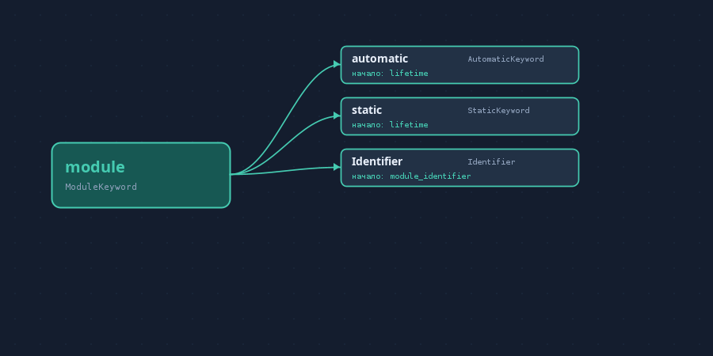

# VerilogGraph

Интерактивный граф видов токенов SystemVerilog на Kotlin/Swing. В левой панели — все 352 `TokenKind` из закреплённой ревизии [slang](https://github.com/MikePopoloski/slang). В центре — вершина и непосредственные допустимые продолжения; щелчок по вершине продвигает просмотр. Для `module` сохраняется грамматический контекст `module_declaration`, так что каждый следующий шаг относится к тому же префиксу конструкции.



## Источники

- [IEEE Std 1800-2023](https://ieeexplore.ieee.org/document/10458102), Annex A — формальный синтаксис. [Страница IEEE](https://standards.ieee.org/ieee/1800/7743/) подтверждает редакцию и бесплатный доступ через IEEE Get. [Публичная копия PDF](https://www.iccircle.com/static/upload/img20240319175450.pdf) использована для сверки правил `module_declaration`.
- [`scripts/grammar.txt`](https://github.com/MikePopoloski/slang/blob/master/scripts/grammar.txt) в slang — текстовая транскрипция Annex A, используемая приложением.
- [`scripts/tokenkinds.txt`](https://github.com/MikePopoloski/slang/blob/master/scripts/tokenkinds.txt) и [`LexerFacts.cpp`](https://github.com/MikePopoloski/slang/blob/master/source/parsing/LexerFacts.cpp) — список видов токенов и их фиксированные написания.

Конкретная ревизия slang указана в [`SOURCE.txt`](src/main/resources/SOURCE.txt). Исходные данные включены в `src/main/resources`; PDF стандарта в репозитории нет. Импорт повторяется командой `python3 tools/import_slang.py /path/to/slang`.

## Запуск

Требуются JDK 17+ и доступ к Maven Central для первого получения плагина Kotlin.

```bash
./gradlew run
./gradlew run --args='--check'
./gradlew run --args='--audit'
./gradlew run --args='--export-dot graph.dot'
./gradlew run --args='--preview preview.png'
```

`--check` проверяет ключевой путь: `module → Identifier → ; → endmodule` и вариант с `automatic`. `--audit` дополнительно печатает обозначения, которые текстовая транскрипция не позволяет однозначно сопоставить с токеном. DOT экспортирует весь полученный граф с правилом происхождения на каждом ребре.
`--preview` сохраняет изображение сценария `module → …` без запуска оконной системы.

## Как устроены переходы

Импортёр читает правила Annex A, преобразует альтернативы, необязательные части и повторения в продукции, затем сопоставляет терминалы с реальными `TokenKind` slang. Граф строится из множеств первых и последних токенов продукций. Пошаговый просмотр `module_declaration` использует распознаватель префиксов Earley, поэтому после выбора `module` выводятся `automatic`, `static` и `Identifier`, а после `module Identifier` — `#`, `(`, `;` и `import`.

При выборе другого токена из списка показывается объединение непосредственных переходов во всей грамматике. В этом режиме каждое ребро обосновано отдельно; составная цепочка может относиться к разным контекстам. Правила и разделы Annex A показаны под графом.

## Границы точности

В текстовой транскрипции потеряно форматирование стандарта, различающее метасимволы грамматики и буквальные знаки. Два заголовка правил в самой опубликованной грамматике набраны как `:: =` и `:=`, поэтому импортёр выводит предупреждения и не подменяет их догадкой. Часть обозначений относится к лексическим деталям, комментариям или путям файлов и не имеет однозначного `TokenKind`; они перечислены в `--audit`. Продукции с неразрешёнными символами исключаются из графа. Поэтому текущий глобальный граф не следует использовать как полное формальное доказательство всех допустимых текстов SystemVerilog. Проверенный сценарий `module` проходит отдельные проверки.

## История изменений

В этой рабочей среде каталог `.git` примонтирован только для чтения, поэтому коммиты проекта хранятся в `.history` и доступны через `tools/git-local.sh log --oneline`. Каталог `.history` не входит в экспорт исходников.
